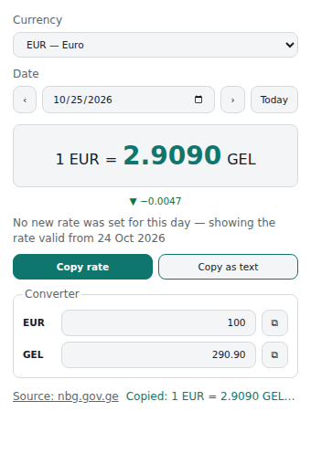
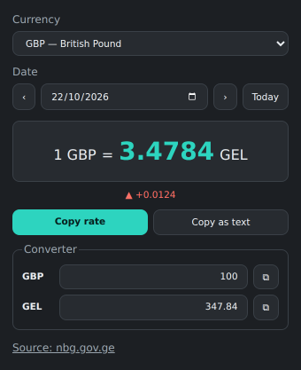

# Lari Rates

Official exchange rates of the **National Bank of Georgia** in your browser toolbar:
pick a currency and a date, see the rate, convert an amount, copy the value in one click.

Works in Firefox, Chrome, Edge, Brave, Opera and other Chromium browsers.
Interface languages: English, Russian, Georgian.

[Русская версия](README.ru.md)

| Light                                                   | Dark (Russian UI)                                     |
| ------------------------------------------------------- | ----------------------------------------------------- |
|  |  |

## What it does

- **Any currency, any date.** All 42 currencies the bank publishes; step through days with
  `‹` `›` or jump back with **Today**.
- **One-click copy.** Click the big rate (or **Copy rate**) to copy `2.9163`.
  **Copy as text** gives `1 EUR = 2.9163 GEL (2026-10-22)`.
- **Converter.** Type an amount on either side — currency → GEL or GEL → currency.
  Accepts `1 000,50` as well as `1000.50`. Each side has its own copy button.
- **Honest dates.** The bank sets no rate on weekends and holidays. If you ask for such a day,
  the popup shows the rate that was in force and says which day it is valid from.
- **Fast and offline-friendly.** Rates for past days never change, so they are cached locally
  and open instantly.
- **Floating window.** The `↗` button next to the currency list moves the popup into its own
  small window. It stays open while you switch tabs, type on a page or copy several values.
  Browsers do not let extensions pin a window above all others, so place it beside the browser
  window if you want it always visible.
- **Keyboard shortcut.** `Alt+Shift+L` opens the popup (change it in your browser's
  extension shortcut settings).
- **Private.** No analytics, no accounts. The only network request goes to `nbg.gov.ge`.
  See [PRIVACY.md](PRIVACY.md).

> **About "buy" and "sell" rates.** The National Bank publishes a single _official_ rate per
> currency — it does not buy or sell cash, so there are no buy/sell prices in its data.
> Those are set by commercial banks and exchange offices and are not available from this source.
> The extension shows the official rate and its change since the previous one.

## Install

The extension is not in the stores yet. Until then, install a build by hand: download the
archive for your browser from the
[latest release](https://github.com/katokdoescode/lari-rates/releases/latest) or build it yourself.

### Firefox

1. Build or download `lari-rates-<version>-firefox.zip` (see [Build](#build-from-source)).
2. Open `about:debugging#/runtime/this-firefox`.
3. Click **Load Temporary Add-on…** and pick the zip (or `manifest.json` inside
   `.output/firefox-mv2/`).

A temporary add-on is removed when Firefox restarts. For a permanent install the build has to be
signed by Mozilla — see [docs/PUBLISHING.md](docs/PUBLISHING.md).

### Chrome, Edge, Brave, Opera

1. Build the extension; you need the folder `.output/chrome-mv3/`
   (or unpack `lari-rates-<version>-chrome.zip`).
2. Open `chrome://extensions` (`edge://extensions`, …) and enable **Developer mode**.
3. Click **Load unpacked** and select that folder.

## Build from source

Requirements: [Node.js](https://nodejs.org) 22+ and [pnpm](https://pnpm.io) 11+.

```bash
pnpm install
pnpm build:all   # .output/chrome-mv3 and .output/firefox-mv2
pnpm zip:all     # zips for Chrome, Firefox, Edge and Opera in .output/
```

## Development

```bash
pnpm dev           # Chrome with hot reload
pnpm dev:firefox   # Firefox with hot reload
pnpm check         # lint + typecheck + tests — run before every commit
```

| Command                                                | What it does                                              |
| ------------------------------------------------------ | --------------------------------------------------------- |
| `pnpm dev` / `pnpm dev:firefox`                        | Start a browser with the extension loaded and live reload |
| `pnpm build` / `pnpm build:firefox` / `pnpm build:all` | Production build into `.output/`                          |
| `pnpm zip` / `pnpm zip:firefox` / `pnpm zip:all`       | Build and pack zips for the stores                        |
| `pnpm test` / `pnpm test:watch` / `pnpm test:coverage` | Run the Vitest suite                                      |
| `pnpm typecheck`                                       | TypeScript, no emit                                       |
| `pnpm lint` / `pnpm lint:fix`                          | Biome lint + format check / autofix                       |
| `pnpm check`                                           | Lint, typecheck and tests together                        |

### Stack

| Tool                                     | Role                                                                 |
| ---------------------------------------- | -------------------------------------------------------------------- |
| [WXT](https://wxt.dev)                   | Extension framework on Vite: one codebase, Manifest V2 and V3 output |
| TypeScript (strict)                      | Language; no UI framework — the popup is ~250 lines of DOM code      |
| [Vitest](https://vitest.dev) + happy-dom | Unit and popup tests                                                 |
| [Biome](https://biomejs.dev)             | Linter and formatter in one binary                                   |
| pnpm                                     | Package manager                                                      |

There are **no runtime dependencies**: the shipped extension is about 25 kB unpacked.

### Project layout

```
src/
  entrypoints/popup/   index.html, style.css, main.ts — wires real browser APIs into the app
  popup/app.ts         popup behaviour, browser-independent (dependencies are injected)
  lib/
    nbg.ts             API client and response validation
    cache.ts           snapshot cache + cache-first loader
    dates.ts           Tbilisi "today", date arithmetic and formatting
    format.ts          rate/amount formatting, conversion, input parsing
    settings.ts        remembered currency and amount
    browser-store.ts   browser.storage.local adapter
    types.ts           shared types
  assets/icon.svg      source icon; PNG sizes are generated at build time
public/_locales/       en, ru, ka translations
tests/                 Vitest suites
docs/                  architecture, API notes, development and publishing guides
store/                 store listing texts, screenshots and promo images
scripts/               store image generator, release notes extractor
```

### Documentation

- [docs/ARCHITECTURE.md](docs/ARCHITECTURE.md) — how the pieces fit and why
- [docs/NBG-API.md](docs/NBG-API.md) — the bank's API as observed, with its quirks
- [docs/DEVELOPMENT.md](docs/DEVELOPMENT.md) — setup, testing, adding currencies/languages, debugging
- [docs/PUBLISHING.md](docs/PUBLISHING.md) — automated releases and publishing to the stores
- [store/README.md](store/README.md) — store listing texts and images
- [CONTRIBUTING.md](CONTRIBUTING.md) — branches, commits, pull requests
- [CHANGELOG.md](CHANGELOG.md)

## Disclaimer

This is an independent project, not affiliated with the National Bank of Georgia.
Rates come from the bank's public API as is; verify them at
[nbg.gov.ge](https://nbg.gov.ge/en/monetary-policy/currency) before relying on them for
accounting or tax purposes.

## License

[MIT](LICENSE)
