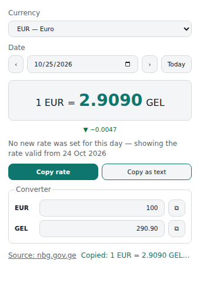
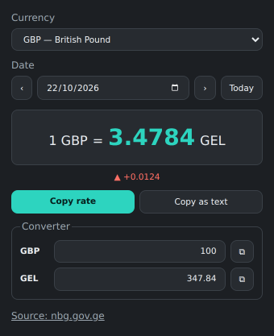

# Lari Rates

Официальные курсы валют **Национального банка Грузии** на панели браузера:
выберите валюту и дату, посмотрите курс, пересчитайте сумму и скопируйте значение одним кликом.

Работает в Firefox, Chrome, Edge, Brave, Opera и других браузерах на Chromium.
Языки интерфейса: английский, русский, грузинский.

[English version](README.md)

| Светлая тема                                             | Тёмная тема                                            |
| -------------------------------------------------------- | ------------------------------------------------------ |
|  |  |

## Возможности

- **Любая валюта на любую дату.** Все 42 валюты, которые публикует банк. Дни листаются кнопками
  `‹` `›`, кнопка **Сегодня** возвращает к текущей дате.
- **Копирование в один клик.** Клик по крупному курсу или **Копировать курс** кладёт в буфер
  `2.9163`. **Копировать текстом** — `1 EUR = 2.9163 GEL (2026-10-22)`.
- **Конвертер.** Вводите сумму с любой стороны: валюта → лари или лари → валюта.
  Понимает и `1 000,50`, и `1000.50`. У каждого поля своя кнопка копирования.
- **Честные даты.** В выходные и праздники банк курс не устанавливает. Если выбрать такой день,
  плагин покажет действовавший курс и напишет, с какого дня он действует.
- **Быстро и без сети.** Курсы за прошедшие дни не меняются, поэтому хранятся локально
  и открываются мгновенно.
- **Плавающее окно.** Кнопка `↗` рядом со списком валют переносит плагин в отдельное небольшое
  окно. Оно не закрывается при переключении вкладок, вводе текста на странице и копировании
  нескольких значений подряд. Закрепить окно поверх всех остальных расширениям браузеры не
  разрешают — чтобы оно было видно всегда, поставьте его рядом с окном браузера.
- **Горячая клавиша.** `Alt+Shift+L` открывает окно плагина (меняется в настройках
  горячих клавиш расширений браузера).
- **Приватность.** Никакой аналитики и аккаунтов. Единственный сетевой запрос — к `nbg.gov.ge`.
  Подробнее в [PRIVACY.md](PRIVACY.md).

> **Про курсы «покупки» и «продажи».** Нацбанк публикует один _официальный_ курс на валюту:
> он не покупает и не продаёт наличные, поэтому цен покупки и продажи в его данных нет.
> Их устанавливают коммерческие банки и обменные пункты, и из этого источника их не получить.
> Плагин показывает официальный курс и его изменение к предыдущему.

## Установка

В магазинах расширений плагина пока нет — сборка ставится вручную. Скачайте архив для своего
браузера со страницы
[последнего релиза](https://github.com/katokdoescode/lari-rates/releases/latest) или соберите сами.

### Firefox

1. Соберите или скачайте `lari-rates-<версия>-firefox.zip` (см. [Сборка](#сборка-из-исходников)).
2. Откройте `about:debugging#/runtime/this-firefox`.
3. Нажмите **Загрузить временное дополнение…** и выберите zip
   (или `manifest.json` из `.output/firefox-mv2/`).

Временное дополнение исчезает после перезапуска Firefox. Для постоянной установки сборку должна
подписать Mozilla — см. [docs/PUBLISHING.md](docs/PUBLISHING.md).

### Chrome, Edge, Brave, Opera

1. Соберите расширение; нужна папка `.output/chrome-mv3/`
   (или распакуйте `lari-rates-<версия>-chrome.zip`).
2. Откройте `chrome://extensions` (`edge://extensions`, …) и включите **Режим разработчика**.
3. Нажмите **Загрузить распакованное расширение** и выберите эту папку.

## Сборка из исходников

Нужны [Node.js](https://nodejs.org) 22+ и [pnpm](https://pnpm.io) 11+.

```bash
pnpm install
pnpm build:all   # .output/chrome-mv3 и .output/firefox-mv2
pnpm zip:all     # zip-архивы для Chrome, Firefox, Edge и Opera в .output/
```

## Разработка

```bash
pnpm dev           # Chrome с горячей перезагрузкой
pnpm dev:firefox   # Firefox с горячей перезагрузкой
pnpm check         # линтер + типы + тесты — запускать перед каждым коммитом
```

Стек: [WXT](https://wxt.dev) (Vite), строгий TypeScript без UI-фреймворка,
[Vitest](https://vitest.dev) + happy-dom, [Biome](https://biomejs.dev), pnpm.
Runtime-зависимостей нет: собранное расширение весит около 25 КБ.

Подробная документация для разработчиков — на английском:

- [README.md](README.md#development) — команды и структура проекта
- [docs/ARCHITECTURE.md](docs/ARCHITECTURE.md) — как устроен плагин и почему
- [docs/NBG-API.md](docs/NBG-API.md) — API банка и его особенности
- [docs/DEVELOPMENT.md](docs/DEVELOPMENT.md) — настройка, тесты, добавление языков, отладка
- [docs/PUBLISHING.md](docs/PUBLISHING.md) — автоматические релизы и публикация в магазинах
- [store/README.md](store/README.md) — тексты и картинки для магазинов расширений
- [CONTRIBUTING.md](CONTRIBUTING.md) — ветки, коммиты, pull request'ы

## Отказ от ответственности

Это независимый проект, не связанный с Национальным банком Грузии. Курсы берутся из публичного
API банка как есть; перед использованием в бухгалтерии или налоговой отчётности сверяйте их на
[nbg.gov.ge](https://nbg.gov.ge/en/monetary-policy/currency).

## Лицензия

[MIT](LICENSE)
